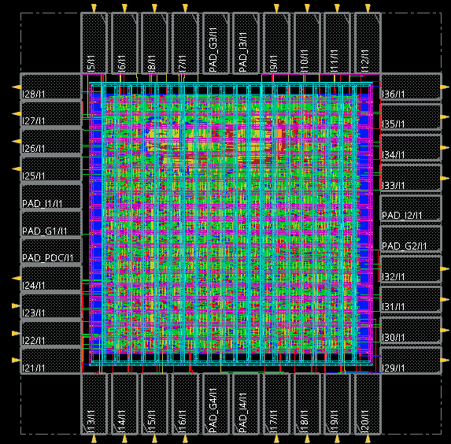

# Wiener Image Filter Accelerator

In this project, we worked on the physical design of a Wiener image filter accelerator. The filter is used to reduce noise in grayscale images.

We used Innovus for the chip layout, Conformal for logic equivalence checks and PrimeTime for timing checks. We also started working with the layout in Virtuoso.

This repository includes backend script examples and pictures from our work.

## Our chip

The picture above shows our chip after routing. The filter circuit is in the middle. The input, output and power pads are around the edges.

## Logic equivalence check

We used Conformal to compare the design before and after physical implementation. The result was **Equivalent**, with one module pair checked and no failed or aborted pairs.

This means the logic matched for the files and settings used in this check.

## Clock tree

The clock tree carries the clock signal to the flip flops in the design.

In the result shown, the clock delay ranges from **0.274 ns to 0.362 ns**. The difference is called clock skew. Our skew was **0.088 ns**, below the **0.300 ns** target.

The clock check showed no clock DAG net violations. The cell list includes **196 clock buffers** and **12 other cells marked as dcg**.

## Timing

After clock tree synthesis, we had **three setup violations**. The worst setup slack was **negative 0.010 ns**. The hold check had no violations, with a worst slack of **positive 0.047 ns**.

After routing and setup optimization, the setup slack improved to **positive 0.479 ns**, with zero total negative slack. The cell density shown was **85.77%**.

We also ran hold optimization. That screenshot shows setup timing numbers, so we cannot use it as the final hold result.

## Power

The leakage power estimate was **0.24418 mW**. The same output lists **267.496 pF** total capacitance and **26,559 instances**.

This is a leakage estimate. A total dynamic power result is not included in these pictures.

## Layout checks

One of our earlier DRC checks found **four spacing violations** near the power pads on M2. The selected problem had **0.500 µm** spacing, while the rule required **1.500 µm**.

The pictures here do not include the final DRC or LVS results.

We also opened the layout in Virtuoso. The saved import picture was taken before we changed the destination library to **EDLib**.

You can see all the pictures and short explanations in the [results gallery](docs/results.md).

## Scripts

The [Conformal folder](lec_gvg/scripts) contains the comparison setup for our two scan chains and clock gating.

The [Innovus folder](innovus/scripts) has examples for the clock source, timing optimization, RC extraction, filler cells and exporting the design. The clock source script only sets the source pin. It does not build the full clock tree.

The [PrimeTime setup folder](primetime/setup/scripts) and [PrimeTime hold folder](primetime/hold/scripts) contain timing check examples.

These scripts cover separate parts of the flow. To run them, you also need the matching design files, constraints, parasitics and licensed libraries.
