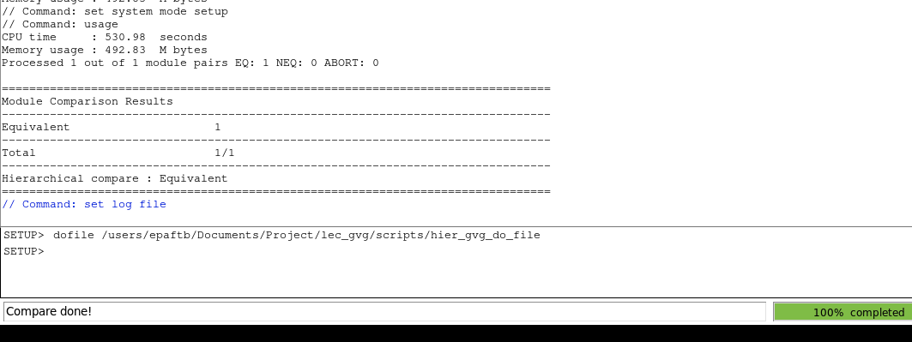
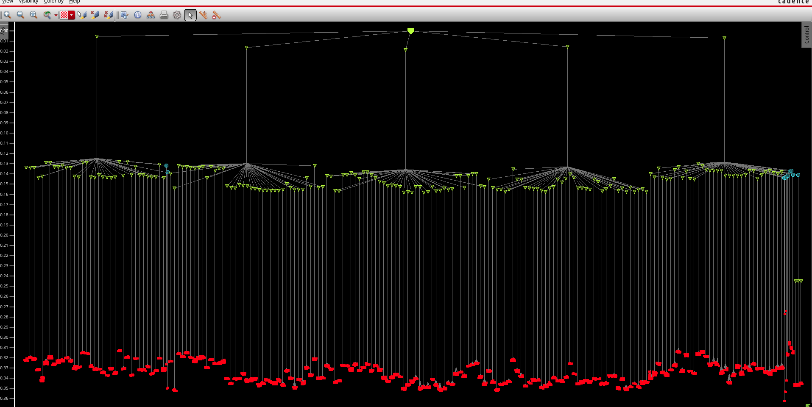
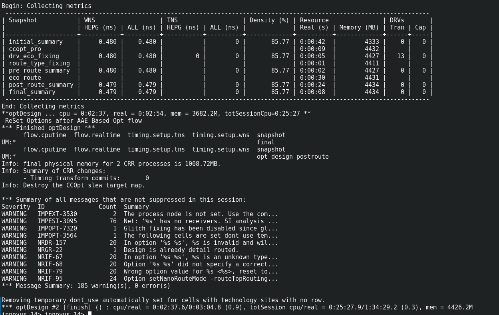

# Wiener Image Filter Accelerator

Physical implementation of a Wiener image filter accelerator using Cadence Innovus, Cadence Conformal and Synopsys PrimeTime, with layout preparation in Cadence Virtuoso.

This repository contains selected implementation scripts and screenshots of the project results. The chip overview shows the routed core, its surrounding power network and the signal and supply pads around the perimeter.

## Logic equivalence

The captured gate to gate comparison completed with an **Equivalent** result. Conformal processed one module pair with zero nonequivalent pairs and zero aborted pairs. The recorded CPU time was 530.98 seconds.

This result applies to the netlists and comparison setup used in the captured run.

## Clock distribution

Clock tree synthesis produced the distribution network shown below. The captured clock DAG check lists no net violations.

The displayed SlowDC setup view has insertion delays from **0.274 ns to 0.362 ns**. Its clock skew is **0.088 ns**, against a target of **0.300 ns**. Average insertion delay is **0.335 ns**.

The cell distribution lists **196 clock buffers** and **12 instances classified as dcg**.

## Timing progress

The earlier timing snapshot shows setup WNS of **negative 0.010 ns**, TNS of **negative 0.018 ns** and **three violating paths** in SlowView. The corresponding FastView hold snapshot shows WNS of **positive 0.047 ns**, zero TNS and zero violating paths.

After routing and setup optimization, the displayed final setup summary shows **positive 0.479 ns WNS**, zero TNS and **85.77% density**.

The separate hold optimization image records a completed run. Its visible timing fields are setup metrics, so they do not establish the final hold slack.

## Power estimate

The captured power summary lists **0.24418 mW total leakage power**, **267.496 pF total capacitance** and **26,559 instances**. It also lists two instances without power values and two without activity values.

These figures describe that captured estimate. The supplied images do not establish total dynamic power or supply voltage drop results.

## Physical verification progress

The supplied DRC snapshot shows **four M2 parallel run length spacing violations** near the core power pads. The selected violation has **0.500 µm actual spacing** against **1.500 µm required spacing**.

This records an intermediate verification state. Final DRC and LVS closure remain to be documented.

The Virtuoso screenshot records an initial stream import form. It shows the technology library in the destination field before that selection was corrected. The design destination is **EDLib**, attached to **tsmcN65**.

The [results gallery](docs/results.md) contains all supplied screenshots and explains what each one demonstrates.

## Scripts

The [Conformal directory](lec_gvg/scripts) contains the gate to gate comparison setup for two scan chains and gated clock modeling.

The [Innovus directory](innovus/scripts) contains clock source declaration, routing optimization, RC extraction, filler insertion and netlist and GDS export examples. The clock source fragment declares the source pin only and does not run a complete clock tree synthesis flow.

The [PrimeTime setup directory](primetime/setup/scripts) and [PrimeTime hold directory](primetime/hold/scripts) contain the corresponding timing analysis examples.

The tools require matching netlists, timing constraints, parasitics and licensed libraries supplied in the working environment. The included scripts are selected flow stages rather than a complete automated implementation.
