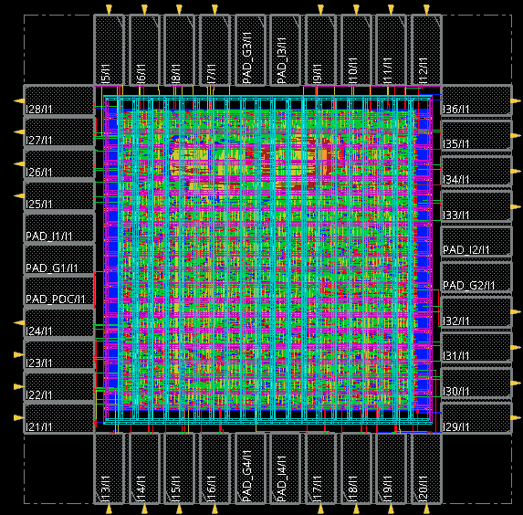
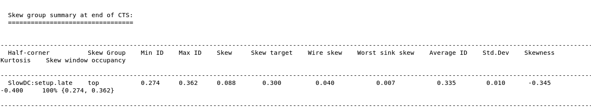
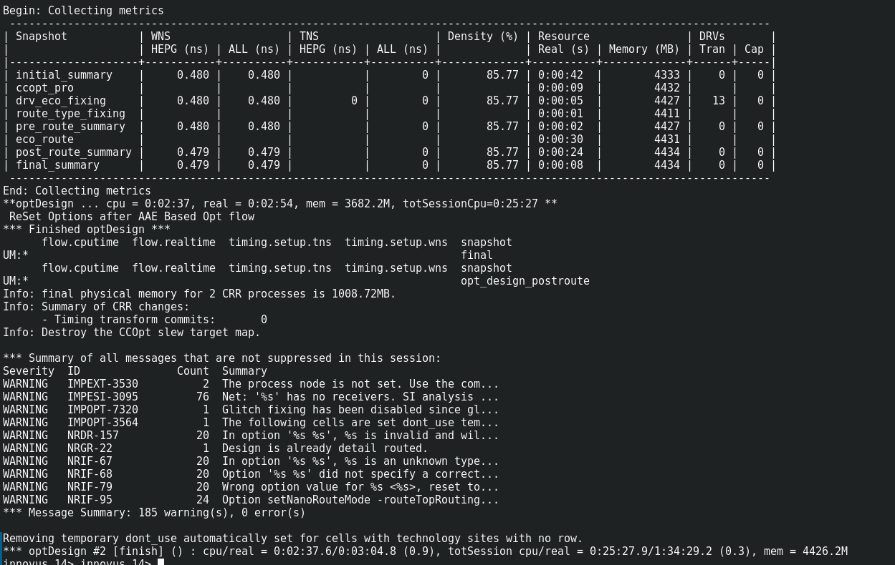
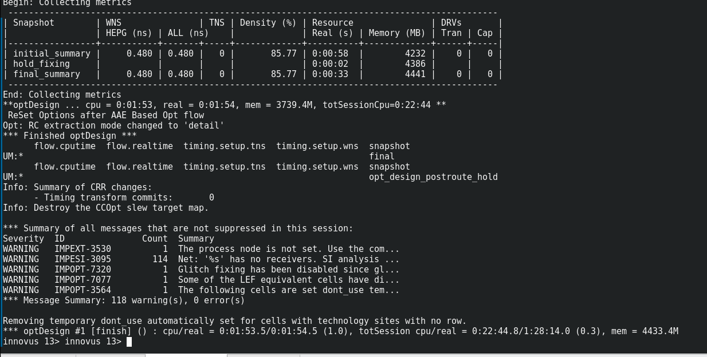
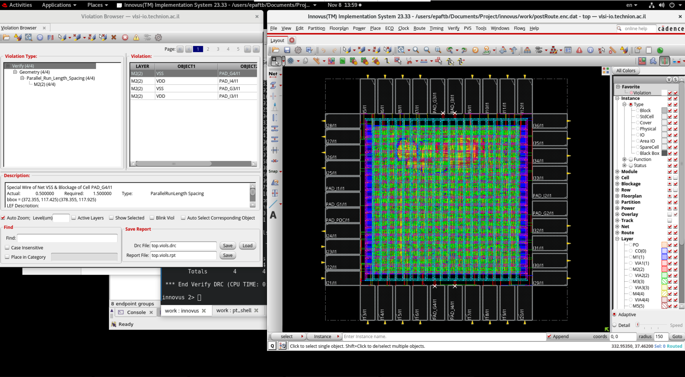

# Implementation Results Gallery

These screenshots document individual stages of the implementation. Each caption describes the visible evidence and its scope.

## Chip overview

The routed core is surrounded by the signal pads, supply pads and power distribution network.

## Completed logic equivalence check

Conformal shows one equivalent module pair, zero nonequivalent pairs and zero aborted pairs. The hierarchical comparison status is Equivalent and the completion indicator is 100%.

CPU time is 530.98 seconds and recorded memory usage is 492.83 Mbytes. These are the values displayed for this run.

## Clock tree topology

The tree view shows the clock distribution branches and their sinks. Its geometry is a topology visualization rather than the physical placement of the chip.

## Setup timing after clock tree synthesis

SlowView has WNS of negative 0.010 ns, TNS of negative 0.018 ns and three violating paths. All three belong to the register to register group.

## Hold timing after clock tree synthesis

FastView has WNS of positive 0.047 ns, zero TNS and zero violating paths in the displayed summary.

## Clock DAG checks

The clock DAG net violation summary states None. This observation concerns the displayed clock checks rather than all physical design rules.

## Clock skew and insertion delay

For SlowDC:setup.late and clock group top, minimum insertion delay is 0.274 ns and maximum insertion delay is 0.362 ns. Skew is 0.088 ns with a target of 0.300 ns. Average insertion delay is 0.335 ns.

## Clock cell distribution

The displayed buffer counts are five CKBD24LVT, three CKBD12LVT and 188 CKBD6LVT, giving 196 clock buffers.

The remaining rows list one AN2D8LVT, four AN2D4LVT, one AN2D2LVT, one CKAN2D2LVT, three CKAN2D1LVT and two CKAN2D0LVT. Those twelve instances are classified as dcg in the captured output.

## Setup optimization after routing

The final displayed setup WNS is positive 0.479 ns and TNS is zero. Density is 85.77%. The message summary records 185 warnings and zero command errors.

Zero command errors does not establish a clean physical DRC result.

## Hold optimization run

This screenshot records a completed hold optimization run with 118 warnings and zero command errors. The visible metric labels say timing.setup, with WNS of positive 0.480 ns and TNS of zero. These values are therefore not presented as final hold slack.

## Leakage estimate

The visible total leakage power is 0.24418 mW. Total capacitance is 2.67496 times ten to the power of negative ten farads, equivalent to 267.496 pF. The summary lists 26,559 instances, two instances without power values and two without activity values.

The image does not provide a total dynamic power result.

## Intermediate spacing violations

The violation browser lists four M2 parallel run length spacing violations involving VDD or VSS and the core power pads PAD_G4/I1, PAD_I4/I1, PAD_G3/I1 and PAD_I3/I1.

The selected VSS violation shows 0.500 µm actual spacing and 1.500 µm required spacing. The screenshot captures an intermediate state and does not demonstrate that the violations were subsequently resolved.

## Initial Virtuoso import form

The saved form shows the input GDS and layer map settings. At the time of this capture the Library field still contains tsmcN65. The intended design destination is EDLib with tsmcN65 attached as its technology library.

This image documents the initial form before that correction. It is not the completed import summary.

