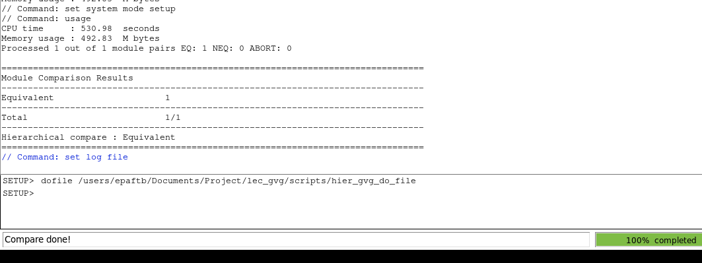
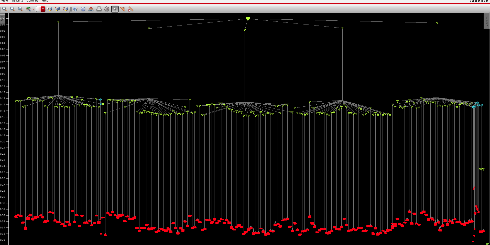
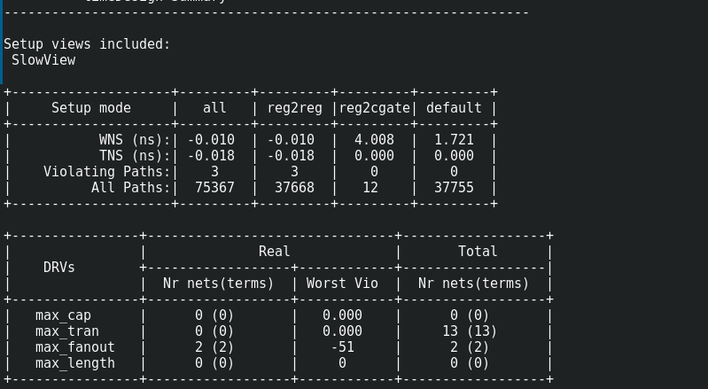
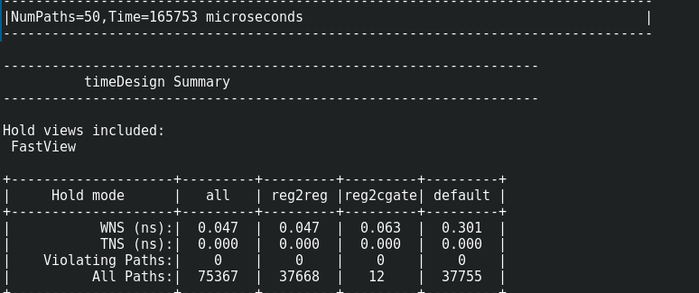
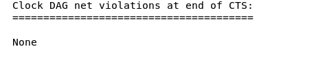
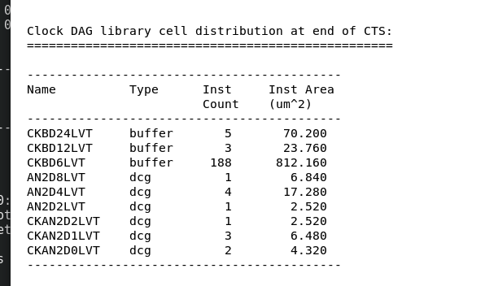
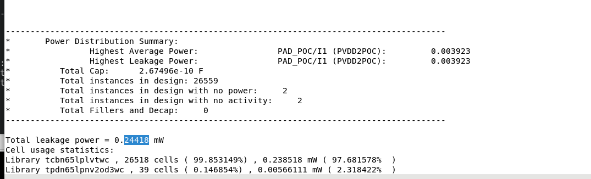
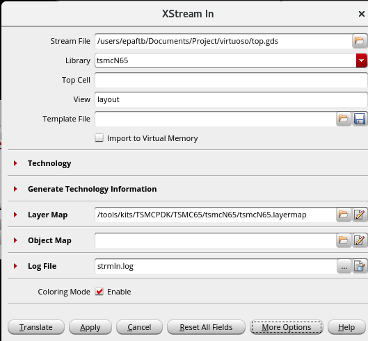

# Pictures and Results

These pictures show different steps of our work. Each explanation describes what we can see in that picture.

## Our chip

This is our chip after routing. The circuit is in the middle, with the signal and power pads around it.

## Logic equivalence check

Conformal finished with an Equivalent result. It checked one module pair, with no failed or aborted pairs. The progress bar reached 100%.

The tool used 530.98 seconds of CPU time and 492.83 Mbytes of memory in this run.

## Clock tree

This view shows how the clock branches out to the flip flops. The branches show the connections in the tree, rather than their actual locations on the chip.

## Setup timing after CTS

The SlowView check found three setup violations between registers. The worst slack was negative 0.010 ns. The total negative slack was negative 0.018 ns.

## Hold timing after CTS

The FastView hold check had no violations. The worst slack was positive 0.047 ns and the total negative slack was zero.

## Clock net check

The clock DAG check found no net violations. This is one clock check, so we still need the other timing and layout checks too.

## Clock delay and skew

In the shown SlowDC setup view, the smallest clock delay was 0.274 ns and the largest was 0.362 ns. The difference was 0.088 ns, which is below the 0.300 ns skew target. The average clock delay was 0.335 ns.

## Cells in the clock tree

The list shows five CKBD24LVT buffers, three CKBD12LVT buffers and 188 CKBD6LVT buffers. Together, these make 196 clock buffers.

There are also twelve other cells marked as dcg. Their cell names and sizes are shown in the picture.

## Setup optimization after routing

After this step, the setup slack was positive 0.479 ns and the total negative slack was zero. The density was 85.77%.

The command finished with 185 warnings and zero errors. The DRC results are checked separately.

## Hold optimization

This picture is from the hold optimization run. The command finished with 118 warnings and zero errors.

Although this run was for hold, the timing numbers shown are labelled as setup. They show positive 0.480 ns WNS and zero TNS. We do not use these numbers as the final hold result.

## Leakage power

The leakage estimate was 0.24418 mW. The output also shows 267.496 pF total capacitance and 26,559 instances.

Two instances have no power values and two have no activity values. The picture does not include a total dynamic power result.

## Spacing problems near the power pads

This earlier DRC check found four M2 spacing violations near PAD_G4/I1, PAD_I4/I1, PAD_G3/I1 and PAD_I3/I1.

The selected problem has 0.500 µm spacing, while the rule requires 1.500 µm. This picture shows the problems at that stage. It does not show that they were fixed later.

## Opening the layout in Virtuoso

This picture shows our first import settings. It was taken before we changed the Library field from tsmcN65 to EDLib.

EDLib holds our design. The tsmcN65 library provides the technology information. This picture shows the settings, rather than the finished import.

